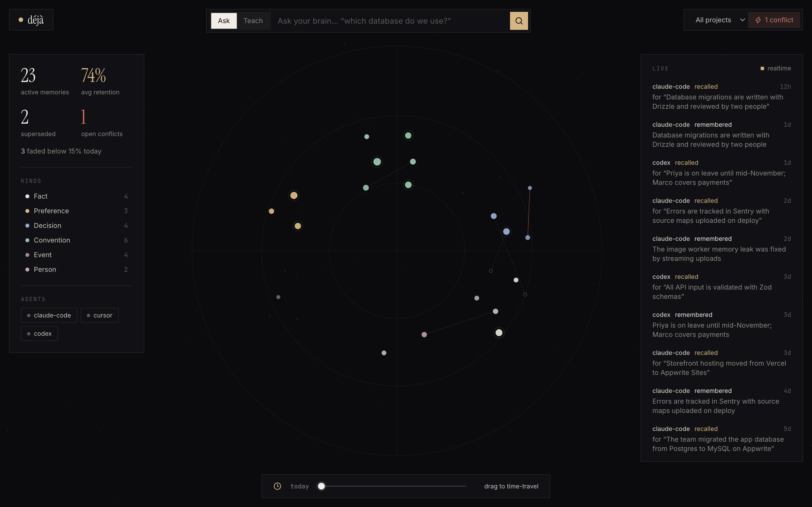
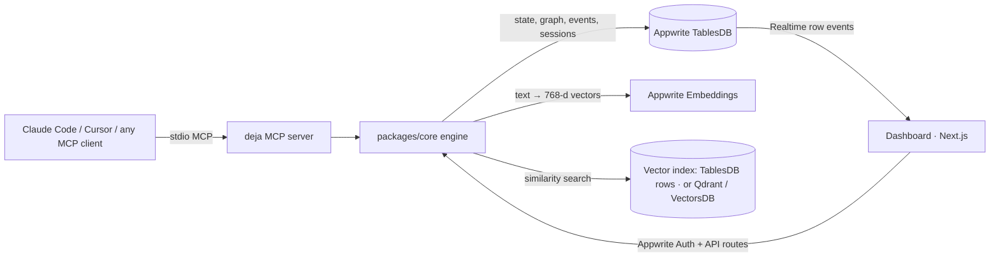

# Déjà

**Long-term memory for AI coding agents that knows when it's wrong.**

Déjà is an MCP server and a live dashboard that give Claude Code, Cursor, Codex or any MCP client a
memory that lasts across sessions and behaves like a brain: it **revises** stale facts, **forgets**
noise on a forgetting curve, and can always **explain** where a memory came from.

Built on **Appwrite TablesDB** for the [Appwrite Databases Hackathon](https://hackathon.appwrite.io) (Oct 2026).

**Live:** https://deja.appwrite.network (hosted on Appwrite Sites) · **[Explore the demo brain](https://deja.appwrite.network/demo)** (no sign-up, read-only)



## The problem

Every coding agent starts each session with amnesia. Memory layers fix that by storing what the agent
learns, but almost all of them only *add*. They remember everything forever, including things that
stopped being true. So the agent confidently tells you to write a Postgres migration three weeks after
you moved to MySQL.

## What Déjà does

| | |
|---|---|
| **It notices when it's wrong** | New information is checked against what Déjà already knows. When something changed, the old memory is **superseded** and the history kept. The agent can say so itself (`remember` with `replaces`), and Déjà's own judge catches changes it didn't name. Genuine disagreements become a **conflict** you resolve in one click. |
| **It forgets like a human** | Every memory decays on a forgetting curve, R = e<sup>−t/S</sup>. Recalling a memory strengthens it, most of all when it was about to fade (spaced repetition). Recall ranks by meaning *and* by how alive a memory is, so noise drops out of the agent's context. |
| **It explains itself** | Every memory carries provenance: which agent stored it, in which session, the original words, and the chain of memories it replaced. Ask "why do you think we use MySQL?" and get a real answer. |
| **You can watch it think** | The dashboard draws the brain as a star chart. Dots appear when memories are stored and ring when recalled; opacity is retention; dashed threads link superseded memories; a red thread marks a conflict. Drag time forward to see what your agent will have forgotten in a month. Everything updates live through Appwrite Realtime. |

### A real session

From Claude Code, in a repo with no database code at all:

```
❯ Heads up: we moved error tracking from Sentry to Highlight. Remember that.
  deja · remember(content: "Error tracking moved from Sentry to Highlight.",
                  replaces: ["ff9edc1b-…"], reason: "Team migrated error tracking off Sentry to Highlight.")
⏺ Noted. The old Sentry memory has been superseded by the new one.

❯ /exit … new session …
❯ Add a migration for an orders table.
⏺ (recalls) → writes a Drizzle schema with mysql-core and a MySQL migration; nothing in the repo said MySQL.

❯ Why do you think we use MySQL?
⏺ "The team migrated the app database from Postgres to MySQL on Appwrite", stored by Claude Code on
  24 Sep. It replaced an older memory, "The app database is Postgres hosted on Supabase."
```

## How it works



**`remember(content, replaces?)`**
1. Split long text into atomic memories and guess each one's kind (fact, preference, decision,
   convention, person, event).
2. Embed it (Appwrite Embeddings) and find nearby memories (vector index), then load their current
   state from TablesDB.
3. Supersede the memories the agent named in `replaces`.
4. For the rest, decide: same memory (strengthen it), an update (supersede the old one), a
   contradiction (open a conflict), related (link them), or unrelated. The default judge uses
   embedding distance plus change and negation cues, with thresholds calibrated on real embeddings.
   An optional Claude-backed judge (`ANTHROPIC_API_KEY`) handles subtler cases.
5. Write the memory, links and an event row; the dashboard updates over Realtime.

**`recall(query)`** ranks by `0.75 × similarity + 0.25 × retention`, hides superseded and faded
memories, warns about open conflicts, and strengthens what it returns.

### Where Appwrite fits

**TablesDB is the source of truth.** Similarity alone can't say a fact went stale; everything that makes
Déjà more than a vector dump lives in four tables in one TablesDB database (`deja`), with row-level
permissions so each user's brain is private:

| Table | What it holds |
|---|---|
| `memories` | content, kind, project, status (`active` / `superseded` / `forgotten`), stability, recall count, last reinforced, superseded-by, provenance (agent, session, excerpt) |
| `links` | the knowledge graph: `supersedes`, `contradicts` (with resolved flag), `supports`, `related`, each with a reason |
| `events` | append-only log (remembered, recalled, superseded, conflict, resolved, forgotten, session); this is what Realtime streams |
| `sessions` | which agents are connected, per project |

Also used: **Appwrite Embeddings** (`nomic-embed-text`, 768-d), **Realtime** (live dashboard),
**Auth** (dashboard sign-in, JWT-verified API routes).

**Vector search.** Appwrite's Free plan allows one database per project and has no VectorsDB pool, so
search sits behind a small `VectorIndex` interface with three backends (`DEJA_VECTOR_BACKEND`):

- `tables` (default): exact cosine search over the user's TablesDB rows, with Appwrite embeddings cached
  per process. No extra service, and always in sync because it reads the source of truth. Fine for
  brains of a few hundred memories; the hosted dashboard and the MCP server both use it.
- `qdrant`: HNSW search in [Qdrant](https://qdrant.tech) (`docker compose up -d`, or Qdrant Cloud) for
  bigger brains. `pnpm reindex` rebuilds it from TablesDB.
- `appwrite`: Appwrite **VectorsDB** with an HNSW cosine index, on a paid Appwrite plan.

## MCP tools

| Tool | What it does |
|---|---|
| `remember` | Store knowledge; pass `replaces` (ids from recall) when something changed |
| `recall` | Search by meaning; ranked, with provenance and conflict warnings |
| `why` | Provenance and history of a memory |
| `conflicts` / `resolve_conflict` | List open contradictions; keep one side after the user decides |
| `forget` | Drop a memory |
| `timeline` | What changed recently |
| prompt `deja_bootstrap` | Load the project's memory, grouped by kind, without strengthening anything |

The server's instructions teach the agent when to use these: recall before assuming, remember durable
facts, and pass `replaces` when the user says something changed.

## Quick start

Requirements: Node 22+, pnpm, an Appwrite Cloud project.

```bash
git clone https://github.com/meanmachine889/Deja.git deja && cd deja
pnpm install
cp .env.example .env          # Appwrite endpoint, project id, server API key
pnpm setup:appwrite           # TablesDB database, tables and indexes
pnpm web                      # dashboard on http://localhost:3100
```

1. In the Appwrite console, enable Email/Password auth and add a Web app with hostname `localhost`.
   The API key needs TablesDB read/write (databases, tables, columns, indexes, rows), `embeddings.write`
   and `users.read`.
2. Sign up at http://localhost:3100/login and copy the owner id it shows into `DEJA_OWNER_ID` in `.env`.
3. Connect Claude Code from the project you want it to remember (Déjà names the project after the
   folder):
   ```bash
   claude mcp add deja -s local -- pnpm -s --dir /path/to/deja mcp
   ```
   Keep the `-s`: without it pnpm prints a banner to stdout and breaks the MCP protocol.
4. Optional: `pnpm seed:demo` loads a two-month demo story into the `acme-shop` project.
   `pnpm seed:demo --owner deja-demo` seeds the public read-only brain served at `/demo`.

No Appwrite project yet? `pnpm web` without an API key serves a seeded **offline demo brain**, and
`DEJA_OFFLINE=1 pnpm mcp` runs the MCP server in memory.

## Scripts

| Command | |
|---|---|
| `pnpm test` | 25 engine tests (vitest): forgetting curve, dedupe, supersede chains, `replaces`, conflicts, recall ranking and isolation, judge thresholds |
| `pnpm smoke` | Live end-to-end check against your Appwrite project and vector index, then cleans up |
| `pnpm mcp:e2e` | Drives the MCP server over stdio like a real client (offline; `-- --live` for Appwrite) |
| `pnpm check:vectorsdb` | Can this Appwrite project create a VectorsDB? |
| `pnpm check:judge` | Checks the optional Claude judge on known cases (needs `ANTHROPIC_API_KEY`) |
| `pnpm seed:demo [--reset]` | Load (or reset and reload) the demo story |

## Repository layout

```
packages/core   memory engine: decay math, judge, engine, TablesDB store, vector backends, demo story
apps/mcp        MCP stdio server
apps/web        Next.js dashboard + landing page
scripts/        setup, smoke test, seed, checks
DEMO.md         two-session demo script
PLAN.md         build plan and session log
```

## Tech stack

Everything here was written from scratch during the hackathon (Oct 19 to 31, 2026). Open-source
libraries used:

- **Appwrite**: `node-appwrite` (server SDK), `appwrite` (web SDK)
- **MCP**: `@modelcontextprotocol/sdk`
- **Vector search (optional backend)**: [Qdrant](https://qdrant.tech) (Docker image, REST API)
- **Web**: Next.js, React, Tailwind CSS, `d3-force` (star-chart layout), `lucide-react` (icons)
- **Validation**: `zod`
- **Optional judge**: `@anthropic-ai/sdk`
- **Tooling**: TypeScript, `tsx`, `vitest`, pnpm workspaces
- **Fonts**: Instrument Serif, Inter, JetBrains Mono (Google Fonts)
